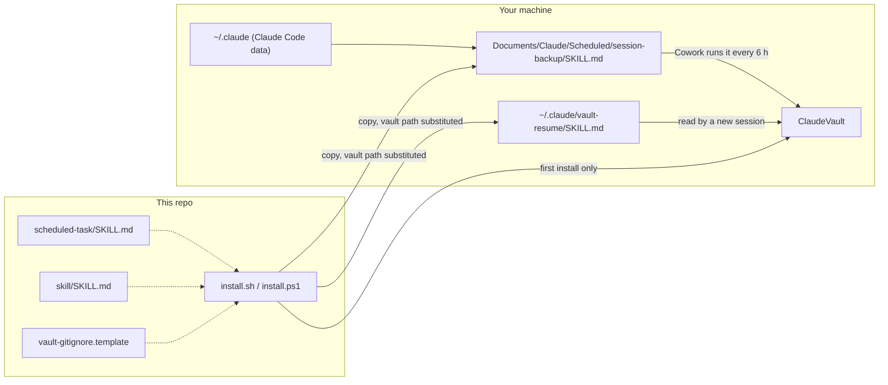
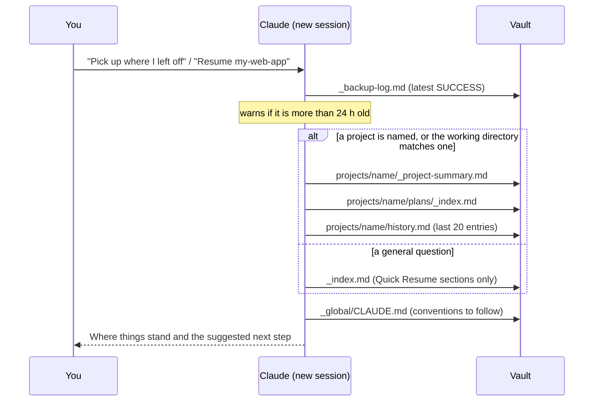

# Architecture

Claude-Backup has no daemon and no backup binary. It is a set of instructions that Claude carries out, plus two small
installers that copy those instructions into place with your vault path filled in.

- [The pieces](#the-pieces)
- [Installers](#installers)
- [The backup task](#the-backup-task)
- [The vault format](#the-vault-format)
- [The skills](#the-skills)
- [Path decoding](#path-decoding)
- [Security model](#security-model)

## The pieces

| Piece                    | File                                                    | Runs as                 | Reads                                                   | Writes                                                     |
| ------------------------ | ------------------------------------------------------- | ----------------------- | ------------------------------------------------------- | ---------------------------------------------------------- |
| Installer (macOS, Linux) | [`install.sh`](../install.sh)                           | bash                    | `skill/`, `scheduled-task/`, `vault-gitignore.template` | The resume skill, the scheduled task, `<vault>/.gitignore` |
| Installer (Windows)      | [`install.ps1`](../install.ps1)                         | PowerShell 5.1+         | Same                                                    | Same                                                       |
| `session-backup`         | [`scheduled-task/SKILL.md`](../scheduled-task/SKILL.md) | A Cowork scheduled task | `~/.claude/`, the Cowork session API                    | The vault                                                  |
| `vault-resume`           | [`skill/SKILL.md`](../skill/SKILL.md)                   | A skill in any session  | The vault                                               | Nothing                                                    |
| `vault-search`           | [`skill-search/SKILL.md`](../skill-search/SKILL.md)     | A skill in any session  | The vault                                               | Nothing                                                    |
| `vault-verify`           | [`skill-verify/SKILL.md`](../skill-verify/SKILL.md)     | A skill in any session  | The vault                                               | Nothing                                                    |

## Installers

Both installers do the same five things, in this order:

1. **Work out the paths.** `install.sh` branches on `$OSTYPE`; `install.ps1` uses `%USERPROFILE%`.

   |                | macOS                                          | Linux                                             | Windows                                                    |
   | -------------- | ---------------------------------------------- | ------------------------------------------------- | ---------------------------------------------------------- |
   | Resume skill   | `~/.claude/vault-resume/`                      | `~/.claude/vault-resume/`                         | `%USERPROFILE%\.claude\vault-resume\`                      |
   | Scheduled task | `~/Documents/Claude/Scheduled/session-backup/` | `~/.local/share/claude/Scheduled/session-backup/` | `%USERPROFILE%\Documents\Claude\Scheduled\session-backup\` |
   | Default vault  | `~/Documents/ClaudeVault`                      | `~/.local/share/ClaudeVault`                      | `%USERPROFILE%\Documents\ClaudeVault`                      |

2. **Handle `--check` / `-Check` and `--uninstall` / `-Uninstall`** and exit. Check reports whether each `SKILL.md`
   exists; uninstall removes the two installed folders and never the vault.
3. **Substitute the vault path.** Every occurrence of the literal `~/Documents/ClaudeVault/` in
   `skill/SKILL.md` and `scheduled-task/SKILL.md` is replaced with `<vault>/` (`sed` on macOS and Linux; a regex
   replace on Windows, which also turns backslashes into forward slashes). The result is written to the two install
   folders.
4. **Protect the vault.** If `<vault>/.gitignore` doesn't exist yet, the vault folder is created and
   `vault-gitignore.template` is copied there. An existing `.gitignore` is never overwritten.
5. **Verify** that both `SKILL.md` files exist, then print the next steps.

`vault-search` and `vault-verify` are not installed by either script and keep the default path.

## The backup task

`session-backup` is a Cowork scheduled task, so Claude runs it inside Cowork's sandbox. At the start it asks for access
to `~/.claude` and `~/Documents` (`request_cowork_directory`), finds the sandbox's mount prefix (`ls /sessions/*/mnt/`)
for its bash commands, and uses the host paths for file tools.

| Step | What it does                                     | Reads                                                                                             | Writes                                                                                                                |
| ---- | ------------------------------------------------ | ------------------------------------------------------------------------------------------------- | --------------------------------------------------------------------------------------------------------------------- |
| 1    | Builds the path-decoding map                     | `history.jsonl`                                                                                   | (in memory)                                                                                                           |
| 2    | Marks the run `IN PROGRESS`, creates the folders | —                                                                                                 | `_backup-log.md`, `_global/`, `projects/`, `cowork/`, `shell-snapshots/`                                              |
| 3    | Global config                                    | `CLAUDE.md`, `settings.json`, `plugins/installed_plugins.json`, `plugins/known_marketplaces.json` | `_global/CLAUDE.md`, `settings-snapshot.md`, `hooks-config.md`, `plugins.md`                                          |
| 4    | History and plans, per project                   | `history.jsonl`, `plans/*.md`                                                                     | `projects/<name>/history.md`, `plans/*.md` (renamed), `plans/_index.md`, `_project-summary.md`                        |
| 5    | Session metadata                                 | `sessions/*.json`                                                                                 | `projects/<name>/sessions/sessions.md`                                                                                |
| 6    | File edit history                                | `file-history/`                                                                                   | `projects/<name>/file-history/`                                                                                       |
| 7    | Shell snapshots                                  | `shell-snapshots/`                                                                                | `shell-snapshots/`                                                                                                    |
| 8    | Conversation transcripts                         | `projects/*/*.jsonl`, Cowork `list_sessions` / `read_transcript`                                  | `projects/<name>/transcripts/<uuid>.md`, `cowork/<id>/transcript.md`, `cowork/<id>/files/`, `cowork/_cowork-index.md` |
| 9    | Master index                                     | Everything above                                                                                  | `_index.md`                                                                                                           |
| 10   | Logs the result                                  | —                                                                                                 | `_backup-log.md` (`SUCCESS` or `PARTIAL`), `.timestamps.json`                                                         |
| 11   | Unmatched plans                                  | Plans with no clear project                                                                       | `projects/_unmatched/plans/`, listed in `_index.md`                                                                   |

**Incremental runs.** `.timestamps.json` maps each source file's absolute path to its modification time. A file whose
mtime hasn't changed and whose vault copy exists is skipped. `stat -f %m` is used on macOS and `stat -c %Y` on Linux,
chosen with `uname -s`. Summaries and indexes are regenerated every run.

**Failure handling.** A failed step is logged in `_backup-log.md` and the run continues. The task never deletes vault
data or overwrites it with less. A run that dies leaves its `IN PROGRESS` marker, which `vault-verify` reports.

**Transcripts.** Each `*.jsonl` line is one message; user and assistant messages are kept, system messages and tool
details are skipped, and the result is written as markdown with timestamps. Directories whose name contains
`local-agent-mode-sessions` are Cowork sessions and go under `cowork/`; everything else goes under `projects/`.

**Plan renaming.** Plans arrive with random names (`binary-singing-lake.md`). They are renamed from their `# Title`:
lowercase, spaces and special characters to hyphens, a leading `Plan:` stripped, at most 60 characters, `-2` and so on
for duplicates.

## The vault format

| File                                      | Contents                                                                                                                                                                                                                                                        |
| ----------------------------------------- | --------------------------------------------------------------------------------------------------------------------------------------------------------------------------------------------------------------------------------------------------------------- |
| `_index.md`                               | Backup time; a table of projects (name, path, latest activity, plans, sessions, status); a Quick Resume per project with the last prompt; recent Cowork sessions; unmatched plans; links to everything                                                          |
| `_backup-log.md`                          | Append-only. A `## Backup Started` / `Status: IN PROGRESS` block at the start of each run, then a `## Backup` block with counts (projects, plans, transcripts by Code and Cowork, history entries, file history, shell snapshots) and `Status: SUCCESS/PARTIAL` |
| `_global/`                                | `CLAUDE.md` (copied), `settings-snapshot.md`, `hooks-config.md`, `plugins.md` (human-readable)                                                                                                                                                                  |
| `projects/<name>/_project-summary.md`     | Path on disk, session count and date range, plans with one-liners, transcript count, files modified, and a detailed **Quick Resume**: last work, decisions, open bugs, file paths, next steps                                                                   |
| `projects/<name>/plans/_index.md`         | `\| # \| Plan \| Topic \| Summary \|` with relative links                                                                                                                                                                                                       |
| `projects/<name>/history.md`              | Every prompt for the project, in order, with timestamps and session IDs                                                                                                                                                                                         |
| `projects/<name>/sessions/sessions.md`    | Sessions with start times, IDs and entrypoint                                                                                                                                                                                                                   |
| `projects/<name>/transcripts/<uuid>.md`   | One conversation, as markdown                                                                                                                                                                                                                                   |
| `projects/<name>/file-history/`           | Versioned snapshots of files Claude edited                                                                                                                                                                                                                      |
| `cowork/_cowork-index.md`, `cowork/<id>/` | Cowork sessions: transcript and output files                                                                                                                                                                                                                    |
| `shell-snapshots/`                        | Copies of `~/.claude/shell-snapshots/`                                                                                                                                                                                                                          |
| `.timestamps.json`                        | `{"<source path>": <mtime in epoch seconds>}` for incremental runs                                                                                                                                                                                              |
| `.gitignore`                              | From `vault-gitignore.template`, on first install                                                                                                                                                                                                               |

Project names come from the last one or two components of the project's path. Timestamps are written for humans
(`Apr 13, 2026 at 2:30 PM`).

## The skills

### vault-resume

Full plan files are read only when you ask about a plan. Plan requests (_"list plans"_, _"show plans for X"_,
_"resume [plan]"_) go through each project's `plans/_index.md`.

### vault-search

Searches in priority order, highest signal first: `plans/*.md`, `_project-summary.md`, `history.md`,
`transcripts/*.md`, then Cowork transcripts. It searches the current project first when the working directory matches
one, groups hits by project with three lines of context, summarises when there are more than 20, and widens concept
searches with related terms (for example `auth` → `login`, `session`, `token`, `JWT`, `OAuth`).

### vault-verify

Reads `_backup-log.md` for the latest run and warns at more than 12, 24 and 72 hours. Checks that `_index.md`,
`_backup-log.md`, `_global/CLAUDE.md` and `projects/` exist, and that each project listed in `_index.md` has
`_project-summary.md`, `history.md` and, where plans are listed, `plans/_index.md`. Reports a short health summary.

## Path decoding

Claude Code keeps each project's conversations in `~/.claude/projects/<encoded path>/`, where the absolute path's `/`
become `-`: `/Users/alice/WebKitchen/my-app` → `-Users-alice-WebKitchen-my-app`. Read back, that is ambiguous whenever
a folder name contains a dash.

The task therefore starts from `history.jsonl`, whose entries carry the real `project` path: it encodes every known
path, builds `{encoded name → real path}`, and looks directory names up in that map. A directory with no history entry
falls back to splitting on `-` and testing candidate paths with `test -d`.

Known gap, tracked on the [roadmap](../README.md#roadmap): the task's encoding rule strips the leading `-`, while the
directory names keep it, and spaces in a path are also stored as `-`. Both send more directories to the fallback than
necessary.

## Security model

- The vault lives on your disk. The installers only copy files, and Claude-Backup never syncs the vault anywhere.
  The backup itself is a Cowork task, so Claude reads your `~/.claude` data while it runs.
- The vault holds whole conversations, so it can contain anything you pasted into Claude. The `.gitignore` keeps
  transcripts, Cowork files, file history, shell snapshots and `.timestamps.json` out of any git repo you sync it to;
  plans, summaries and history are treated as safe to sync.
- The skills only read the vault. Only the backup task writes to it, and it never deletes.
- `--uninstall` / `-Uninstall` removes only the two installed folders.
